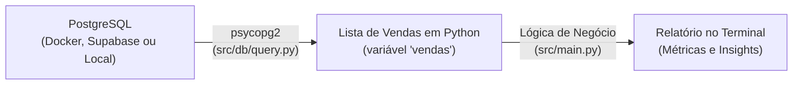

# 🚀 Desafio: Primeira Análise de Dados com Python e PostgreSQL

Bem-vindo(a) ao seu primeiro projeto de **Análise de Dados com Python e Banco de Dados Relacional**!

Este repositório foi projetado especialmente para iniciantes. Aqui você aprenderá, na prática, como configurar um ambiente de desenvolvimento profissional, conectar o Python ao banco de dados **PostgreSQL**, estruturar um banco com dados realistas do mercado brasileiro (utilizando dados oficiais do **IBGE**) e extrair métricas de negócio essenciais para tomada de decisão.

---

## 📌 Sumário Navegável

1. [Visão Geral e Arquitetura](#-visão-geral-e-arquitetura)
2. [Pré-requisitos e Ferramentas Recomendadas](#-pré-requisitos-e-ferramentas-recomendadas)
3. [Etapa 1: Instalação e Preparação do Ambiente Python](#-etapa-1-instalação-e-preparação-do-ambiente-python)
4. [Etapa 2: Configuração e Carga do Banco de Dados (Schema e Seeds)](#-etapa-2-configuração-e-carga-do-banco-de-dados-schema-e-seeds)
   - [2.1. Escolha onde rodar o PostgreSQL (Supabase, Docker ou Local)](#21-inicializando-o-servidor-postgresql)
   - [2.2. Criando o Schema](#22-criando-o-schema-do-banco-databaseschemasql)
   - [2.3. Populando com Seeds](#23-populando-o-banco-com-seeds-dados-realistas)
5. [Etapa 3: Executando a Análise de Dados (src/main.py)](#-etapa-3-executando-a-análise-de-dados-srcmainpy)
6. [Estrutura de Pastas do Projeto](#-estrutura-de-pastas-do-projeto)
7. [Desafios Extras para Praticar](#-desafios-extras-para-praticar)
8. [Solução de Dúvidas e Problemas Frequentes](#-solução-de-dúvidas-e-problemas-frequentes)

---

## 🏗️ Visão Geral e Arquitetura

O projeto simula o ecossistema real de um e-commerce brasileiro:



- **PostgreSQL**: Armazena as tabelas relacionais com dados reais de estados e municípios do Brasil (IBGE), clientes, catálogo de produtos, endereços, pedidos e pagamentos. Pode rodar **na nuvem (Supabase)**, em **container (Docker)** ou **instalado localmente**.
- **`src/db/query.py`**: Conecta-se ao PostgreSQL e executa uma consulta com agregações em JSON, retornando registros ricos em formato de dicionário Python.
- **`src/main.py`**: O script principal que você executará. Ele recebe esses dados na variável `vendas`, processa agregações e exibe um relatório analítico formatado.

---

## 📋 Pré-requisitos e Ferramentas Recomendadas

Antes de começar, certifique-se de ter instalado em sua máquina:

1. **Python 3.10 ou superior**: [Download do Python](https://www.python.org/downloads/) _(marque a opção "Add Python to PATH" durante a instalação no Windows)_.
2. **Git**: [Download do Git](https://git-scm.com/).
3. **Servidor PostgreSQL (Escolha 1 das opções)**:
   - ☁️ **Opção 1: Supabase (Nuvem Gratuita - Altamente Recomendado)**: Não quer ou não pode instalar Docker nem PostgreSQL no seu computador? O [Supabase](https://supabase.com/) fornece uma instância completa de PostgreSQL na nuvem gratuitamente, configurada em menos de 2 minutos pelo navegador.
   - 🐳 **Opção 2: Docker Compose (Container Local)**: Se você já tem o [Docker Desktop](https://www.docker.com/products/docker-desktop/), o projeto inclui um arquivo `docker-compose.yml` para subir o PostgreSQL com 1 comando.
   - 💻 **Opção 3: PostgreSQL Tradicional**: Instalador oficial para quem prefere rodar o serviço nativo na máquina: [Download PostgreSQL](https://www.postgresql.org/download/).
4. **Interface Visual para o Banco (Cliente SQL)**:
   - 🐝 **Recomendado: [Beekeeper Studio](https://www.beekeeperstudio.io/)**: Moderno, leve, visualmente limpo e extremamente amigável para iniciantes (ótima alternativa moderna ao pgAdmin).
   - 🌐 **SQL Editor Web do Supabase**: Se você optar pelo Supabase, o próprio painel web possui um editor SQL integrado, dispensando qualquer instalação adicional.
   - 🐘 **Alternativa Tradicional**: [pgAdmin 4](https://www.pgadmin.org/).

---

## ⚙️ Etapa 1: Instalação e Preparação do Ambiente Python

Nesta etapa, vamos criar um **ambiente virtual** para isolar as bibliotecas do projeto e instalar as dependências necessárias.

### 1.1. O que é um Ambiente Virtual (`venv`) e por que usamos?

No Python, cada projeto pode precisar de versões diferentes de bibliotecas. O ambiente virtual (`venv`) cria uma pasta isolada no seu projeto, garantindo que as bibliotecas instaladas aqui não interfiram no restante do seu computador.

### 1.2. Criando o Ambiente Virtual

Abra o terminal (PowerShell, CMD ou Bash) na pasta raiz do projeto e execute:

```bash
python -m venv venv
```

> Isso criará uma pasta chamada `venv/` contendo uma cópia isolada do interpretador Python.

### 1.3. Ativando o Ambiente Virtual

A ativação varia conforme o seu sistema operacional:

- **No Windows (PowerShell):**

  ```powershell
  .\venv\Scripts\Activate.ps1
  ```

  _(Se encontrar erro de política de execução no PowerShell, execute antes: `Set-ExecutionPolicy -Scope Process -ExecutionPolicy Bypass`)_

- **No Windows (Prompt de Comando / CMD):**

  ```cmd
  venv\Scripts\activate.bat
  ```

  ou

  ```cmd
  source venv/Scripts/activate
  ```

- **No Linux ou macOS (Bash/Zsh):**
  ```bash
  source venv/bin/activate
  ```

> 💡 **Como saber se deu certo?** O início da linha do seu terminal exibirá o prefixo `(venv)`.

### 1.4. Instalando as Dependências

Com o ambiente ativado, instale os pacotes listados no `requirements.txt`:

```bash
pip install -r requirements.txt
```

As bibliotecas instaladas são:

1. `psycopg2-binary`: Driver que permite ao Python conversar e executar comandos SQL no PostgreSQL.
2. `python-dotenv`: Lê configurações sensíveis (como senhas e hosts) de um arquivo `.env`.
3. `faker`: Gera dados fictícios realistas (nomes, e-mails, telefones e endereços no padrão brasileiro).

### 1.5. Configurando o Arquivo `.env`

O Python precisa saber onde está o banco de dados e qual usuário/senha utilizar. Duplique o modelo `.env.example`:

- **No Windows (PowerShell):**
  ```powershell
  Copy-Item .env.example .env
  ```
- **No Linux/macOS:**
  ```bash
  cp .env.example .env
  ```

Abra o arquivo `.env` gerado e preencha de acordo com a opção de banco que você escolheu:

#### Se for usar Docker Compose ou PostgreSQL Local:

```env
DB_HOST=localhost
DB_PORT=5432
DB_NAME=db_vendas
DB_USER=admin
DB_PASSWORD=adminpassword
```

#### Se for usar o Supabase (Nuvem):

No painel do seu projeto no Supabase, vá em **Project Settings** > **Database** > **Connection Parameters** (ou Connection Pooling) e preencha:

```env
DB_HOST=aws-0-sa-east-1.pooler.supabase.com
DB_PORT=5432
DB_NAME=postgres
DB_USER=postgres.seu_id_do_projeto
DB_PASSWORD=sua_senha_do_supabase
```

---

## 🗄️ Etapa 2: Configuração e Carga do Banco de Dados (Schema e Seeds)

Agora que o Python está configurado, precisamos preparar o **PostgreSQL**, criar a estrutura de tabelas (**Schema**) e popular essas tabelas com dados de teste (**Seeds**).

### 2.1. Inicializando o Servidor PostgreSQL

Escolha a opção que melhor se adapta ao seu ambiente:

#### Opção A: Usando Supabase na Nuvem (Sem instalar nada no computador)

1. Acesse [supabase.com](https://supabase.com/) e crie uma conta gratuita.
2. Clique em **New Project**, defina um nome (ex: `desafio-vendas`), uma senha forte e escolha a região mais próxima (ex: `São Paulo (sa-east-1)`).
3. Pronto! Seu PostgreSQL está ativo na nuvem. Copie os dados de conexão para o seu arquivo `.env`.

#### Opção B: Usando Docker Compose (Local e rápido)

Se você tem o Docker instalado, execute na raiz do projeto:

```bash
docker compose up -d
```

> O container iniciará em segundo plano já com o banco `db_vendas` criado na porta `5432`.

#### Opção C: Usando PostgreSQL Local Tradicional

Se instalou o PostgreSQL na sua máquina:

1. Abra o **Beekeeper Studio** ou o **pgAdmin**.
2. Conecte-se ao seu servidor local e crie um novo banco de dados chamado `db_vendas`.

---

### 2.2. Criando o Schema do Banco (`database/schema.sql`)

O arquivo `database/schema.sql` contém o DDL (comandos `CREATE TABLE`) com toda a modelagem relacional:

- `estados` e `cidades` (integrados aos códigos oficiais do IBGE)
- `enderecos` e `clientes`
- `categorias` e `produtos`
- `vendas`, `pagamentos` e `itens_venda`

Você pode aplicar o schema usando qualquer uma das ferramentas abaixo:

#### 🐝 Pelo Beekeeper Studio (Recomendado)

1. Abra o **Beekeeper Studio** e clique em **New Connection** -> **PostgreSQL**.
2. Preencha os dados de host, porta, usuário e senha (do Supabase, Docker ou Local) e clique em **Connect**.
3. Clique no botão de nova aba de consulta SQL (**New Query**).
4. Abra o arquivo `database/schema.sql`, copie todo o conteúdo, cole no Beekeeper Studio e clique no botão verde **Run** (ou atalho `Ctrl + Enter` / `Cmd + Enter`).
5. As 9 tabelas serão criadas instantaneamente!

#### 🌐 Pelo SQL Editor Web do Supabase

1. No painel do seu projeto no Supabase, clique na aba **SQL Editor** no menu lateral esquerdo.
2. Clique em **New Query**.
3. Cole o conteúdo do arquivo `database/schema.sql` e clique em **Run**.

#### 💻 Pelo Terminal (Para quem usa Docker ou psql)

- **Com Docker Compose:**
  ```bash
  docker exec -i desafio_postgres psql -U admin -d db_vendas < database/schema.sql
  ```
- **Com PostgreSQL Local via terminal:**
  ```bash
  psql -h localhost -p 5432 -U admin -d db_vendas -f database/schema.sql
  ```

---

### 2.3. Populando o Banco com Seeds (Dados Realistas)

Com as tabelas criadas, precisamos preenchê-las com dados.

> ⚠️ **Atenção à Ordem de Execução:** Em bancos relacionais, tabelas com chaves estrangeiras (Foreign Keys) dependem que as tabelas pai existam primeiro! A ordem correta e obrigatória é:
>
> 1. `states-seed.sql` _(estados brasileiros)_
> 2. `cities-seed.sql` _(cidades vinculadas aos estados)_
> 3. `categories-seed.sql` _(categorias de produtos)_
> 4. `products-seed.sql` _(produtos vinculados às categorias)_
> 5. `customers-seed.sql` _(clientes cadastrados)_
> 6. `addresses-seed.sql` _(endereços vinculados às cidades)_
> 7. `sales-seed.sql` _(vendas, pagamentos e itens de venda)_

#### Como executar a carga:

- **Via Beekeeper Studio ou SQL Editor do Supabase:**
  Abra cada um dos arquivos da pasta `database/seeds/` na ordem numérica indicada acima, cole no editor e execute um por um.

- **Via Terminal (Docker Compose em lote):**
  ```bash
  docker exec -i desafio_postgres psql -U admin -d db_vendas < database/seeds/states-seed.sql
  docker exec -i desafio_postgres psql -U admin -d db_vendas < database/seeds/cities-seed.sql
  docker exec -i desafio_postgres psql -U admin -d db_vendas < database/seeds/categories-seed.sql
  docker exec -i desafio_postgres psql -U admin -d db_vendas < database/seeds/products-seed.sql
  docker exec -i desafio_postgres psql -U admin -d db_vendas < database/seeds/customers-seed.sql
  docker exec -i desafio_postgres psql -U admin -d db_vendas < database/seeds/addresses-seed.sql
  docker exec -i desafio_postgres psql -U admin -d db_vendas < database/seeds/sales-seed.sql
  ```

#### Método Opcional: Gerar uma nova massa de dados personalizada

Se você quiser gerar um volume customizado de registros (ex: 500 clientes, 800 produtos e 5.000 vendas), pode rodar o script gerador:

```bash
python scripts/gerar_seed.py --users 500 --products 800 --sales 5000
```

> O script consome a API do IBGE, combina com a biblioteca Faker e regera os arquivos na pasta `database/seeds/`. Depois, basta executá-los no seu banco.

---

## 📊 Etapa 3: Executando a Análise de Dados (src/main.py)

Com o banco configurado e populado, você está pronto para rodar a sua primeira análise de dados!

### 3.1. Como Executar

Certifique-se de que o ambiente virtual `(venv)` está ativo e execute a partir da raiz do projeto:

```bash
python src/main.py
```

### 3.2. O que o script faz nos bastidores?

1. **Conexão**: Chama a função `obter_relatorio_vendas()` do módulo [`src/db/query.py`](file:///C:/Users/emmerson.oliveira/Documents/developer/python/desafio-analise-de-dados-com-sql/src/db/query.py).
2. **Armazenamento**: Guarda a lista de vendas retornada na variável `vendas`.
3. **Cálculos Analíticos**:
   - **Faturamento Total e Líquido**: Soma o valor dos pedidos e segrega apenas os concluídos.
   - **Ticket Médio**: Calcula a receita média gerada por cada pedido aprovado.
   - **Distribuição de Status**: Avalia o percentual de pedidos concluídos, cancelados e pendentes.
   - **Preferência de Pagamentos**: Mede a proporção entre PIX, Boleto e Cartão de Crédito (além da média de parcelamento).
   - **Top Categorias**: Identifica quais departamentos do e-commerce geram maior receita.
   - **Distribuição Geográfica**: Identifica os estados brasileiros que mais realizam compras na loja.

### 3.3. Exemplo do Relatório Gerado no Terminal

```text
[1/2] Conectando ao PostgreSQL e executando a consulta...
[2/2] 20,000 registros recuperados com sucesso! Iniciando a análise...

===========================================================================
  RELATÓRIO DE ANÁLISE DE DADOS - E-COMMERCE BRASIL
===========================================================================
Total de registros analisados: 20,000 vendas

1. VISÃO GERAL FINANCEIRA
---------------------------------------------------------------------------
  • Faturamento Total (Todos os pedidos): R$ 175.908.073,88
  • Faturamento Líquido (Apenas CONCLUÍDOS): R$ 149.803.638,86
  • Ticket Médio por Venda Concluída:     R$ 8.791,81

2. DISTRIBUIÇÃO POR STATUS DO PEDIDO
---------------------------------------------------------------------------
  • CONCLUIDO      :  17039 pedidos ( 85.2%)
  • CANCELADO      :   1975 pedidos (  9.9%)
  • PENDENTE       :    986 pedidos (  4.9%)

3. MÉTODOS DE PAGAMENTO
---------------------------------------------------------------------------
  • PIX             :   6721 ( 33.6%)
  • BOLETO          :   6658 ( 33.3%)
  • CARTAO_CREDITO  :   6621 ( 33.1%) (Média: 6.6 parcelas)

4. TOP CATEGORIAS MAIS VENDIDAS (Pedidos Concluídos)
---------------------------------------------------------------------------
  Categoria                  | Qtd Itens  | Faturamento      | % Total
  -----------------------------------------------------------------------
  Redes e Conectividade      | 11414      | R$ 19.945.707,46 |  13.3%
  Móveis de Escritório       | 10757      | R$ 19.495.261,40 |  13.0%
  Periféricos                | 11485      | R$ 19.478.598,05 |  13.0%

5. TOP 5 ESTADOS COM MAIOR VOLUME DE COMPRAS
---------------------------------------------------------------------------
  UF     | Vendas   | Faturamento      | % Receita
  ------------------------------------------------
  MG     | 2574     | R$ 22.609.812,03 |  15.1%
  SP     | 2025     | R$ 17.918.675,36 |  12.0%
===========================================================================
```

---

## 📂 Estrutura de Pastas do Projeto

```text
desafio-analise-de-dados-com-sql/
│
├── database/                   # Modelagem e arquivos SQL
│   ├── schema.sql              # Criação das tabelas relacionais
│   ├── vendas_exemplo.json     # Exemplo do formato de dados retornado
│   └── seeds/                  # Arquivos SQL com dados gerados
│       ├── states-seed.sql
│       ├── cities-seed.sql
│       ├── categories-seed.sql
│       ├── products-seed.sql
│       ├── customers-seed.sql
│       ├── addresses-seed.sql
│       └── sales-seed.sql
│
├── scripts/
│   └── gerar_seed.py           # Script Python que gera seeds via IBGE + Faker
│
├── src/
│   ├── db/
│   │   └── query.py            # Função de conexão psycopg2 e consulta SQL
│   └── main.py                 # PONTO DE ENTRADA: Script de análise de dados
│
├── .env.example                # Modelo das variáveis de ambiente (Local / Supabase)
├── .gitignore                  # Arquivos ignorados no controle de versão
├── docker-compose.yml          # Configuração para subir o PostgreSQL com Docker
├── requirements.txt            # Dependências Python do projeto
└── README.md                   # Este guia completo passo a passo
```

---

## 🎯 Desafios Extras para Praticar

Quer ir além e exercitar suas habilidades de programação e análise? Abra o arquivo [`src/main.py`](file:///C:/Users/emmerson.oliveira/Documents/developer/python/desafio-analise-de-dados-com-sql/src/main.py) e tente implementar:

1. **Top Clientes**: Crie um ranking com os 5 clientes que mais gastaram no e-commerce.
2. **Dia da Semana com Maior Faturamento**: Descubra se os clientes compram mais no final de semana ou durante a semana.
3. **Análise de Cancelamentos**: Identifique se há algum método de pagamento específico que possui taxa de cancelamento anormalmente alta.

---

## ❓ Solução de Dúvidas e Problemas Frequentes

### 1. `psycopg2.OperationalError: could not connect to server`

- **Causa**: O banco de dados PostgreSQL não está rodando ou as portas/credenciais no `.env` estão divergentes.
- **Solução**:
  - Se estiver usando o **Docker**: verifique se o container está ativo (`docker ps`).
  - Se estiver usando o **Supabase**: verifique sua conexão com a internet e se o host e usuário foram preenchidos corretamente no `.env`.
  - Se estiver usando o **PostgreSQL Local**: confirme se o serviço do Postgres foi iniciado no sistema operacional.

### 2. `relation "vendas" does not exist`

- **Causa**: As tabelas ainda não foram criadas no banco de dados.
- **Solução**: Execute o arquivo `database/schema.sql` via Beekeeper Studio, Supabase SQL Editor ou terminal antes de tentar consultar ou rodar os seeds (veja o item [2.2](#22-criando-o-schema-do-banco-databaseschemasql)).

### 3. `ModuleNotFoundError: No module named 'psycopg2'`

- **Causa**: O script foi executado fora do ambiente virtual.
- **Solução**: Certifique-se de ter ativado o ambiente virtual (`venv`) antes de rodar o comando (o terminal deve exibir `(venv)`).

---

🎉 **Parabéns!** Você configurou um ambiente profissional de análise de dados de ponta a ponta. Bom aprendizado!
